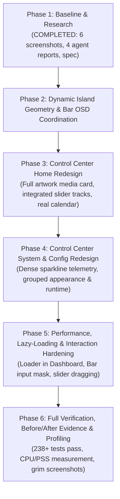

# IMPLEMENTATION PLAN: QUICKSHELL DYNAMIC ISLAND & CONTROL CENTER REDESIGN

**Date**: 2026-11-12  
**Author**: Lead Engineer  
**Target Repository**: `/home/admin/Projects/dotfiles/.worktrees/quickshell` (Branch: `quickshell`)  
**Design Spec Reference**: [`docs/superpowers/specs/2026-11-12-dynamic-island-dashboard-redesign.md`](file:///home/admin/Projects/dotfiles/.worktrees/quickshell/docs/superpowers/specs/2026-11-12-dynamic-island-dashboard-redesign.md)  
**Baseline Test Status**: 238/238 passing tests  

---

## 1. Overview & Phased Architecture

---

## 2. Detailed Task Breakdown

### Phase 2: Dynamic Island Geometry & Bar OSD Coordination
- [ ] **Task 2.1**: Update `IslandShape.qml`:
  - Eliminate the vertical border seams between the central pill body and the concave anti-corner ears (`border.width: 0` on inner pill body).
  - Add continuous border strokes along the concave Bézier curve in `antiCornerLeft` and `antiCornerRight` (`strokeColor: root.borderColor; strokeWidth: 1`).
  - Enforce radius budgeting: $R_{\text{ear}} + R_b \le H$ to prevent arc overlap.
  - Zero stroke along top bezel line ($y = 0$).
- [ ] **Task 2.2**: Resolve Top Bar and Overlay Island Collision:
  - In `bar/Bar.qml`, add reactive coordination with `Island.qml`: smoothly fade out `centerIsland` (`opacity: 0.0`) when `Island.qml` triggers an active OSD or notification alert, and restore it (`opacity: 1.0`) when dismissed.
  - Verify that `qs ipc call rice islandOsd 󰕾 0.65` renders cleanly at the top center without widget double-drawing.

---

### Phase 3: Control Center Home Redesign
- [ ] **Task 3.1**: Redesign `PlayerCard.qml`:
  - Full-bleed artwork background: `Image` with `fillMode: Image.PreserveAspectCrop`.
  - 3-stop vertical dark gradient overlay (`0.35` -> `0.65` -> `0.90`) for text/button readability.
  - Interactive track progress seek bar with elapsed and total timestamps.
  - Fallback state: Check `image.status === Image.Ready`, render clean dark gradient with centered `󰎆` glyph on error or missing player.
- [ ] **Task 3.2**: Redesign `QuickSettings.qml`:
  - Eliminate the 75px+ empty gap (`Item { Layout.fillHeight: true }`).
  - Implement integrated `SliderRow` tracks for volume and brightness: the track is the container (height 34px), with left-docked icon, active fill bar, and right-docked percentage readout (`75%`). Enable continuous pointer dragging!
  - 2-column compact grid of 6 tiles (Wi-Fi, Bluetooth, Mute, DND, Night Light, Awake) with height 38px, subtle accent tint when active, clean typography.
- [ ] **Task 3.3**: Redesign `CalendarCard.qml`:
  - Replace hardcoded 28-cell Monday model with dynamic month calculation (first weekday offset + real month days 28-31).
  - Clean day-of-week header, muted out-of-month days, accent ring on today.
- [ ] **Task 3.4**: Refine `ProfileCard.qml` & `ClockCard.qml`:
  - Profile: Avatar status dot, bold username, host subtitle, compact uptime badge.
  - Clock: Large digital clock with tabular digits (`tnum: 1`) to eliminate jitter, formatted date.

---

### Phase 4: Control Center System & Config Redesign
- [ ] **Task 4.1**: Redesign `System.qml`:
  - Eliminate giant empty 2x2 cards and dead vertical spacers.
  - Top summary pill strip: Hostname, kernel, and session uptime.
  - CPU card: Usage percentage, model name, and 20-point `Sparkline` (historical CPU load via `QtQuick.Shapes` `PathPolyline`).
  - RAM card: Used / Total GB, percentage, and memory pressure indicator.
  - Storage card: Root filesystem (/) used / total GB, filesystem type, and clean progress bar.
  - Health & Session card: Live load average, thermal readout / battery status, and Wayland display info.
  - Connect all telemetry dynamically to `dashboard/telemetry.py`.
- [ ] **Task 4.2**: Redesign `Config.qml`:
  - Eliminate the 50% dead vertical space in both columns.
  - Group into Appearance (Dark/Light pill buttons, palette regeneration, expanded color swatches with labels) and Runtime (compact reload buttons for Quickshell, Hyprland, Theme Tokens).
  - Clear button hierarchy with subtle accent borders on primary actions.

---

### Phase 5: Performance, Lazy-Loading & Interaction Hardening
- [ ] **Task 5.1**: Implement Lazy Loading in `Dashboard.qml`:
  - Replace eager static instantiation of `Home`, `System`, and `Config` with `Loader { active: dashboardWindow.visible; source: ... }`.
  - Verify that when Control Center is closed, zero `python3 telemetry.py` processes are spawned and background timers are stopped.
- [ ] **Task 5.2**: Add Input Mask in `Bar.qml`:
  - Add exact `mask: Region { Region { item: leftIsland } Region { item: centerIsland } Region { item: rightIsland } }`.
  - Verify clicks in transparent gaps pass through to wallpaper/windows underneath.
- [ ] **Task 5.3**: Optimize Animations & Batching:
  - Remove redundant `clip: true` in `Island.qml`, `Dashboard.qml`, and `Launcher.qml`.
  - Calibrate `SpringAnimation` epsilon to `0.25` in `IslandShape.qml` to prevent infinite sub-pixel re-renders at 144Hz.
  - Align top bar clock timer to minute boundary in `Bar.qml`.

---

### Phase 6: Verification, Evidence & Completion
- [ ] **Task 6.1**: Update and expand unit test suite:
  - Verify all 238 existing tests pass cleanly.
  - Add tests for `Loader` lazy-loading, seamless anti-corners, and slider drag in `tests/test_dashboard_control_center.py`.
- [ ] **Task 6.2**: Capture fresh after screenshots:
  - Capture updated screenshots of top bar, Control Center Home, System, Config, and Island OSD.
  - Document before/after visual comparison.
- [ ] **Task 6.3**: Performance Measurement:
  - Measure CPU and PSS/RSS memory footprint using `smaps_rollup`.
- [ ] **Task 6.4**: Commit on branch `quickshell` and update status artifact.
